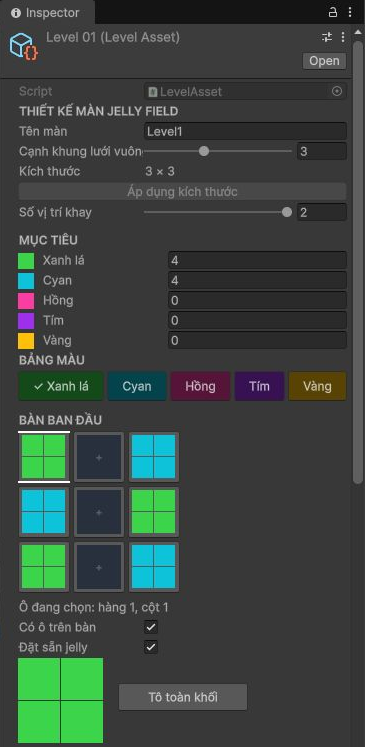
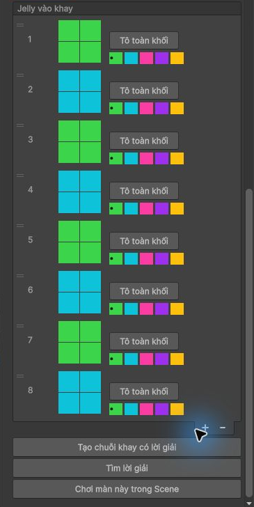

# JellyField

A recreation of Jelly Field gameplay built with Unity 3D for Android, featuring three levels. Players drag jelly pieces from the tray onto the board, matching adjacent regions of the same color to clear them and complete each level’s goals. The project uses DOTween, UniTask, and Shader Graph for animations and jelly deformation, with a responsive UI for mobile screens.

🎬 [Watch the gameplay video](https://www.youtube.com/shorts/CEx4Z_VsmpQ)

https://github.com/user-attachments/assets/e06fd6fe-7f0b-4e21-bfde-230e575b75d4

## Level Editor

Levels are configured with ScriptableObjects and a custom Unity Inspector. Designers can edit the board mask, paint jelly colors, set collection goals, and arrange the tray sequence without changing gameplay code. The editor also includes tools to find a winning route and generate a tray sequence with a verified solution.

| Board and goals | Tray sequence and level tools |
| --- | --- |
|  |  |

